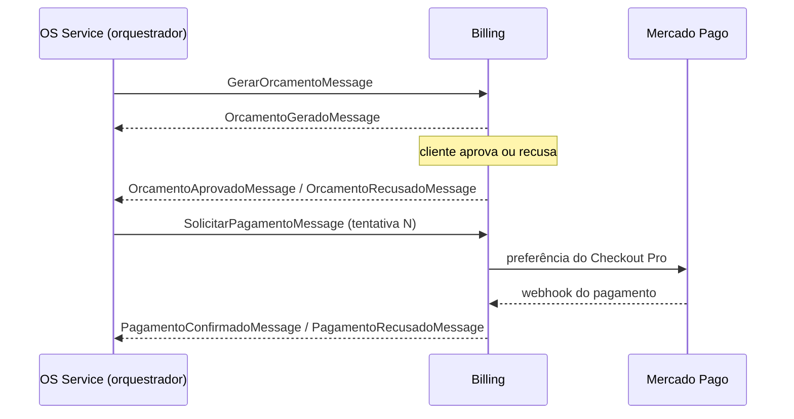

# Billing Service — Oficina Mecânica

[](https://sonarcloud.io/summary/new_code?id=tech-challenge-grupo-160_tech-challenge-oficina-mecanica-billing) [](https://sonarcloud.io/summary/overall?id=tech-challenge-grupo-160_tech-challenge-oficina-mecanica-billing)

Microsserviço de orçamento e pagamento da oficina mecânica, desenvolvido na Fase 4 do Tech Challenge FIAP SOAT pelo Grupo 160.

**Responsabilidade:** gerar o orçamento a partir do diagnóstico, registrar a
decisão do cliente (aprovação ou recusa) e cobrar a OS no Mercado Pago,
confirmando o pagamento por webhook.

## Papel na Saga

A OS é coordenada por uma **Saga orquestrada pelo OS Service**
([ADR-0004](https://github.com/tech-challenge-grupo-160/tech-challenge-oficina-mecanica/blob/develop/docs/adrs/0004-saga-orquestrada.md);
a justificativa está no [README do OS Service](https://github.com/tech-challenge-grupo-160/tech-challenge-oficina-mecanica#saga-orquestrada)).
O Billing é um participante: recebe comandos do orquestrador, executa a
transação local no DynamoDB e publica o resultado. Ele não conhece a Execução
nem altera o status da OS.



Na recusa do orçamento, o OS cancela a OS. Na recusa do pagamento, o OS pede
uma nova tentativa, porque o pagamento é o passo repetível da Saga.

## Banco: DynamoDB

Uma tabela por ambiente, `tc-grupo160-<ambiente>-billing` (sob demanda, chave
`PK`/`SK`, índice `GSI1` e TTL), provisionada em [infra/dynamodb.tf](infra/dynamodb.tf)
([ADR-0006](https://github.com/tech-challenge-grupo-160/tech-challenge-oficina-mecanica/blob/develop/docs/adrs/0006-banco-por-servico.md)).
Orçamentos, pagamentos (um por tentativa), Inbox e Outbox ficam na mesma
tabela. Cada mudança de estado grava o item e o evento da Outbox na mesma
`TransactWriteItems`, com escrita condicional, o que garante a publicação
única e a idempotência.

## Pagamento no Mercado Pago (F4-20)

O pagamento usa o **Checkout Pro**, em ambiente de teste.

1. Ao consumir `SolicitarPagamentoMessage`, o Billing grava o `Pagamento` e cria
   uma preferência no Mercado Pago com o valor do orçamento aprovado e
   `external_reference = os:<ordemServicoId>;pagamento:<pagamentoId>`. O link
   (`init_point`) fica em `linkPagamento` no
   `GET /api/v1/pagamentos/ordem-servico/{ordemServicoId}`.
2. O Mercado Pago avisa em `POST /api/v1/pagamentos/webhook` (tópico `payment`).
   O Billing valida o `x-signature` com a assinatura secreta do webhook
   (HMAC-SHA256 sobre `id:<data.id>;request-id:<x-request-id>;ts:<ts>;`) e
   responde `401` se ela não bater.
3. O status **nunca** vem do corpo da notificação: o Billing consulta
   `GET /v1/payments/{id}` na API, localiza o pagamento pela referência externa e
   confere o valor.
4. `approved` grava `Confirmado` e publica `PagamentoConfirmadoMessage`;
   `cancelled` (pagamento cancelado ou expirado) grava `Recusado` e publica
   `PagamentoRecusadoMessage`. `rejected` é só uma **tentativa** recusada: no
   Checkout Pro o comprador pode tentar de novo na mesma página, e cada tentativa
   é um pagamento novo no Mercado Pago. O pagamento continua `Pendente` e o
   desfecho é `Aguardando`. Status intermediários (`pending`, `in_process`...)
   também não mudam nada: o Mercado Pago avisa de novo quando o status mudar.
5. Notificações repetidas são idempotentes: o pagamento só sai de `Pendente` uma
   vez (escrita condicional no DynamoDB, junto com a Outbox), então o evento é
   publicado uma única vez e o webhook responde `200` com desfecho `Duplicada`.

### Pagamento recusado e nova tentativa (F4-27)

O pagamento é o passo **repetível** da Saga (ADR-0004): depois de uma recusa
nada é desfeito, e o OS Service pede uma nova cobrança com
`SolicitarPagamentoMessage` e `tentativa` + 1.

- Cada tentativa é um `Pagamento` próprio, com Id derivado da saga e da tentativa
  (`Pagamento.GerarId`). Comandos repetidos para a mesma tentativa caem no mesmo
  item do DynamoDB, então não há cobrança duplicada.
- A tentativa N só é aceita se a N-1 estiver `Recusado`.
- `GET /api/v1/pagamentos/ordem-servico/{ordemServicoId}` devolve a tentativa
  mais recente; `tentativa` vem na resposta e nos eventos de pagamento.
- Fora da nuvem, `PATCH /api/v1/pagamentos/ordem-servico/{ordemServicoId}/{pagamentoId}/simular-recusa?motivo=...`
  provoca a recusa (só em Development/Testing, como o `simular-confirmacao`).

### Credenciais

As credenciais ficam no AWS Secrets Manager, em `tc-grupo160/<ambiente>/mercadopago`
(JSON com `access_token` e `webhook_secret`), e nunca no repositório. No cluster o
pod recebe só o nome do segredo (`MercadoPago__SecretId`) e lê o valor no startup.
Sem o segredo preenchido o pod sobe mesmo assim, **sem cobrança**: os orçamentos
funcionam, o webhook responde `404` e o log da subida diz o motivo. Preencha o
segredo e reinicie os pods.

| Configuração | Uso |
|---|---|
| `MercadoPago__Enabled` | liga a integração (desligada, o pagamento segue pelo fluxo simulado) |
| `MercadoPago__SecretId` | nome do segredo no Secrets Manager (cluster) |
| `MercadoPago__AccessToken` / `MercadoPago__WebhookSecret` | só execução local, por `dotnet user-secrets` ou variável de ambiente |
| `MercadoPago__NotificationUrl` | opcional; vazio usa a URL configurada no painel do Mercado Pago |

Trocar o segredo exige reiniciar os pods:
`kubectl rollout restart deployment/oficina-mecanica-billing -n oficina-mecanica`.

A rota do webhook é pública no API Gateway (`POST /api/v1/pagamentos/webhook`, sem
JWT, criada na F4-14 no `tech-challenge-infra-k8s`), porque o Mercado Pago não manda
token do sistema. A regra do ALB para `/api/v1/pagamentos*` entrega a chamada ao
Billing. A proteção é a validação do `x-signature`. No painel do Mercado Pago, a
URL de notificação é `<gateway_url>/api/v1/pagamentos/webhook`.

Um pagamento recusado é final: uma aprovação que chegue depois da recusa é
ignorada e registrada em log, porque a saga já compensou a OS. O estorno (F4-21)
está fora do escopo (ADR-0004).

## Contratos

Todas as mensagens têm versão 1, `MessageId` (idempotência) e `CorrelationId`
(a saga da OS). O catálogo completo está no
[repositório do OS Service](https://github.com/tech-challenge-grupo-160/tech-challenge-oficina-mecanica/blob/develop/docs/mensageria/catalogo.md).

### Comandos consumidos (SQS)

| Mensagem | Fila | Origem | O que faz |
|---|---|---|---|
| `GerarOrcamentoMessage` | `...-billing-gerar-orcamento` | OS Service | Gera o orçamento com os snapshots do diagnóstico |
| `SolicitarPagamentoMessage` | `...-billing-solicitar-pagamento` | OS Service | Cria o pagamento da tentativa e a cobrança no Mercado Pago |

### Eventos publicados (SNS `tc-grupo160-<ambiente>-billing-events`)

| Mensagem | Quando |
|---|---|
| `OrcamentoGeradoMessage` | Orçamento calculado e enviado ao cliente |
| `OrcamentoAprovadoMessage` | Cliente aprovou |
| `OrcamentoRecusadoMessage` | Cliente recusou (com motivo) |
| `PagamentoConfirmadoMessage` | Mercado Pago aprovou o pagamento |
| `PagamentoRecusadoMessage` | Pagamento cancelado ou expirado no Mercado Pago |

O atributo `tipo` de cada publicação leva o nome da classe, e é por ele que as
filas do OS Service filtram a assinatura.

### Endpoints

| Método | Rota | Uso |
|---|---|---|
| `GET` | `/api/v1/orcamentos/ordem-servico/{ordemServicoId}` | Consultar o orçamento da OS |
| `PATCH` | `/api/v1/orcamentos/{ordemServicoId}/{orcamentoId}/aprovar` | Cliente aprova |
| `PATCH` | `/api/v1/orcamentos/{ordemServicoId}/{orcamentoId}/recusar` | Cliente recusa (corpo: `motivo`) |
| `GET` | `/api/v1/pagamentos/ordem-servico/{ordemServicoId}` | Consultar o pagamento vigente (link do Checkout Pro) |
| `POST` | `/api/v1/pagamentos/webhook` | Notificação do Mercado Pago (pública, validada por `x-signature`) |
| `PATCH` | `/api/v1/pagamentos/ordem-servico/{ordemServicoId}/{pagamentoId}/simular-confirmacao` | Só em Development/Testing |
| `PATCH` | `/api/v1/pagamentos/ordem-servico/{ordemServicoId}/{pagamentoId}/simular-recusa` | Só em Development/Testing |

O contrato OpenAPI está em [docs/openapi/billing.json](docs/openapi/billing.json);
o Swagger UI fica em `/swagger` no ambiente de desenvolvimento. Na AWS, as rotas
chegam pelo API Gateway (com o authorizer JWT, exceto o webhook) e pelo ALB,
que encaminha `/api/v1/orcamentos*` e `/api/v1/pagamentos*` ao Billing.

## Estrutura

```
src/
  API/              controllers, bootstrap, filtros, ProblemDetails
  Application/      comandos, consultas e handlers (MediatR), validação
  Domain/           entidades e regras de negócio
  Infrastructure/   persistência, mensageria, health checks, logs
  Shared/           código compartilhado entre camadas (LogTemplate)
tests/
  Fiap.TechChallenge.OficinaMecanica.Billing.Test.UnitTests/
  Fiap.TechChallenge.OficinaMecanica.Billing.Test.IntegrationTests/
infra/              Terraform SNS/SQS, DLQs e configuração no Secrets Manager
docker/backend/     Dockerfile (desenvolvimento, build e runtime com o tracer)
k8s/                Deployment, Service, HPA e ConfigMap (Kustomize)
```

A infraestrutura de mensageria e os passos de provisionamento estão em
[infra/README.md](infra/README.md). O catálogo comum está no
[repositório OS Service](https://github.com/tech-challenge-grupo-160/tech-challenge-oficina-mecanica/blob/develop/docs/mensageria/catalogo.md).

## Como rodar

O Billing usa o LocalStack (SNS, SQS e DynamoDB) que sobe no compose do OS
Service. Para o fluxo completo com os três serviços, siga o
[guia de execução local](https://github.com/tech-challenge-grupo-160/tech-challenge-oficina-mecanica/blob/develop/docs/EXECUCAO-LOCAL.md).

Com o compose do OS Service já de pé, no Billing:

```bash
cp .env.example .env
docker compose up -d --build
```

A API fica disponível em `http://localhost:8081` e o Swagger em `http://localhost:8081/swagger`.
A tabela DynamoDB é criada no LocalStack na subida. Localmente o Mercado Pago fica
desligado, e o pagamento é confirmado ou recusado pelos endpoints `simular-*`.

## Testes

```bash
dotnet test Fiap.TechChallenge.OficinaMecanica.Billing.slnx \
  --collect:"XPlat Code Coverage" \
  --settings coverlet.runsettings
```

Os testes cobrem domínio, validações, handlers, idempotência e transação no DynamoDB, contratos de mensagens e endpoint HTTP. A meta do Quality Gate é cobertura mínima de 80% em código novo.

**Cobertura:** 93,0% na última análise de PR, com o quality gate aprovado
([painel no SonarCloud](https://sonarcloud.io/summary/overall?id=tech-challenge-grupo-160_tech-challenge-oficina-mecanica-billing)).
O badge no topo mostra a análise da branch principal.

O fluxo completo da OS, com as compensações, é coberto pelo
[BDD do OS Service](https://github.com/tech-challenge-grupo-160/tech-challenge-oficina-mecanica#bdd-do-fluxo-completo-da-os-f4-36).

## Pipeline

O [`pipeline.yml`](.github/workflows/pipeline.yml) chama o pipeline reutilizável
[`servico-dotnet.yml@v1`](https://github.com/tech-challenge-grupo-160/tech-challenge-pipelines):

| Gatilho | O que roda |
|---|---|
| PR para `develop`, `homolog` ou `main` | build, testes, SonarCloud e build da imagem |
| push na `homolog` / `main` | imagem no ECR e deploy no EKS de homologação / produção |
| disparo manual | deploy no ambiente escolhido (dev) |

O `terraform-messaging.yml` cuida da mensageria e da tabela DynamoDB
(`infra/`): roda o plan nos PRs e aplica no push da `develop`.

## Mercado Pago

O pagamento usa o **Checkout Pro**. As credenciais (access token e assinatura do
webhook) ficam no AWS Secrets Manager, em `tc-grupo160/<ambiente>/mercadopago`,
e nunca no repositório. Produto escolhido, contas de teste e o passo a passo para
gerar as credenciais estão em [docs/MERCADO-PAGO.md](docs/MERCADO-PAGO.md).

## Repositórios relacionados

| Serviço | Repositório |
|---|---|
| OS Service | [tech-challenge-oficina-mecanica](https://github.com/tech-challenge-grupo-160/tech-challenge-oficina-mecanica) |
| Billing | [tech-challenge-oficina-mecanica-billing](https://github.com/tech-challenge-grupo-160/tech-challenge-oficina-mecanica-billing) |
| Execução | [tech-challenge-oficina-mecanica-execucao](https://github.com/tech-challenge-grupo-160/tech-challenge-oficina-mecanica-execucao) |
| Infraestrutura (rede, EKS, API Gateway, ALB) | [tech-challenge-infra-k8s](https://github.com/tech-challenge-grupo-160/tech-challenge-infra-k8s) |
| Bancos RDS | [tech-challenge-infra-database](https://github.com/tech-challenge-grupo-160/tech-challenge-infra-database) |
| Lambda de autenticação | [tech-challenge-lambda-auth](https://github.com/tech-challenge-grupo-160/tech-challenge-lambda-auth) |
| Pipeline reutilizável | [tech-challenge-pipelines](https://github.com/tech-challenge-grupo-160/tech-challenge-pipelines) |

Diagramas da arquitetura: [docs/diagrams do OS Service](https://github.com/tech-challenge-grupo-160/tech-challenge-oficina-mecanica/tree/develop/docs/diagrams).

Fluxo de branches: `feature/*` → `develop` → `homolog` → `main`; `homolog` e
`main` só recebem alterações por PR.
